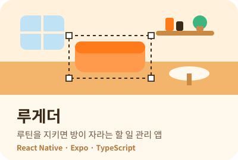
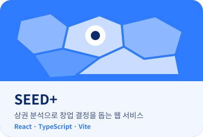
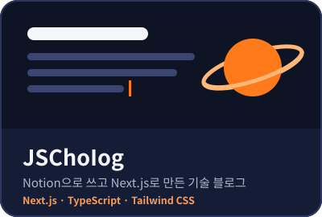

사용자가 화면과 주고받는 상호작용에서 즐거움을 느껴 프론트엔드를 선택했습니다.
AI 에이전트와 함께 개발하고, 확인한 것은 테스트로 남깁니다.

## Projects

  
  
  

## 요즘 하는 것

- 사용자가 실제로 하는 흐름을 E2E 테스트(Playwright)로 확인하기
- AI 에이전트가 쓴 코드를 검증하는 방법 찾기
- 배운 것은 [블로그](https://jschoiog.site)에 정리하기

## Contact

[Blog](https://jschoiog.site) · [Portfolio](https://jschoiog.site/portfolio) · evan7484@naver.com
